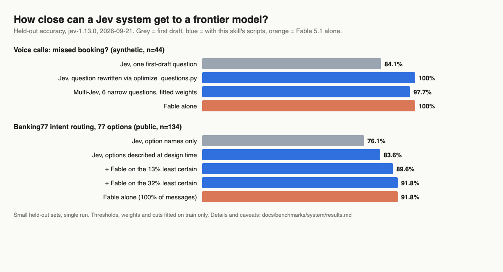
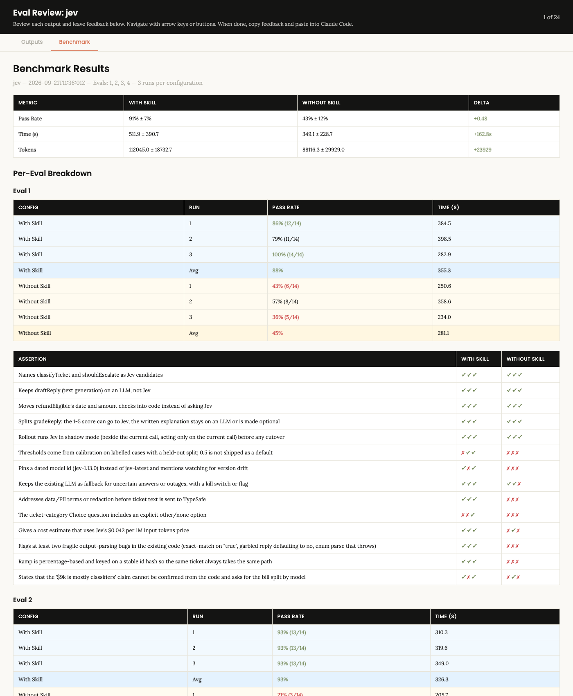
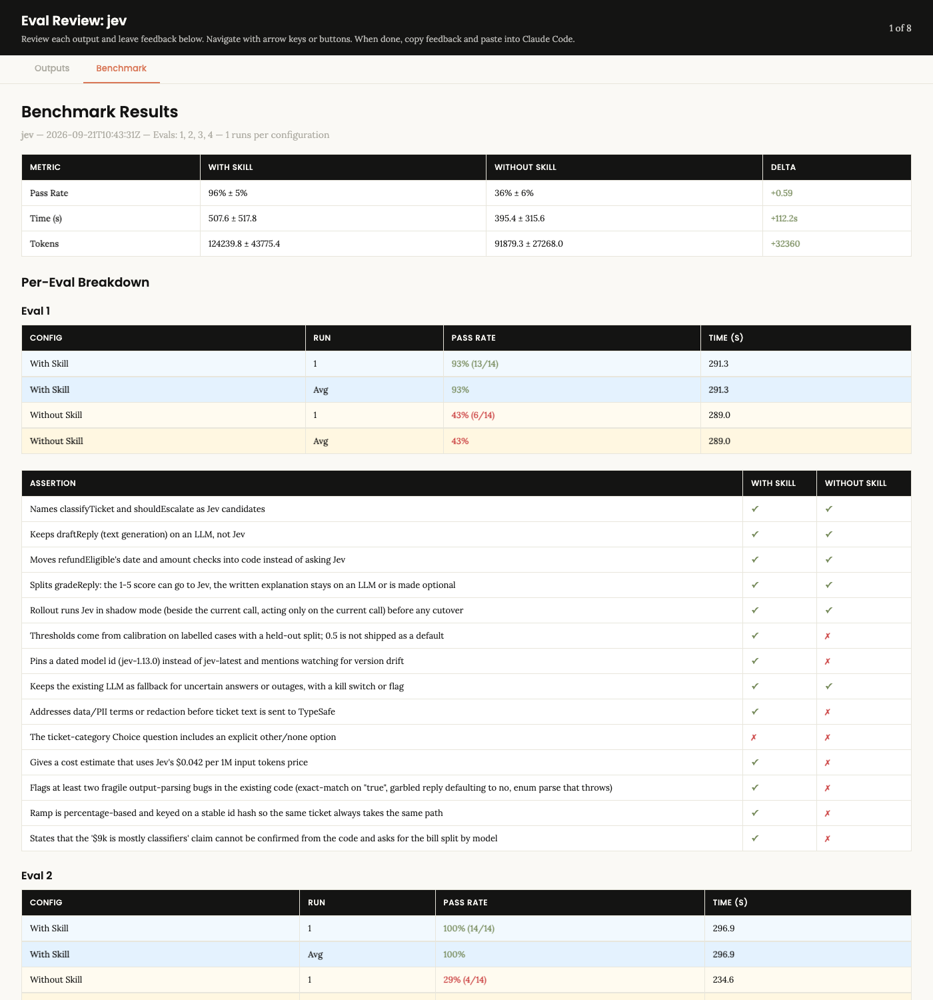
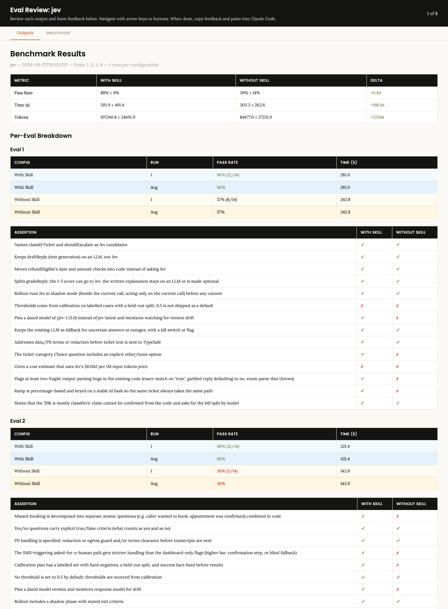
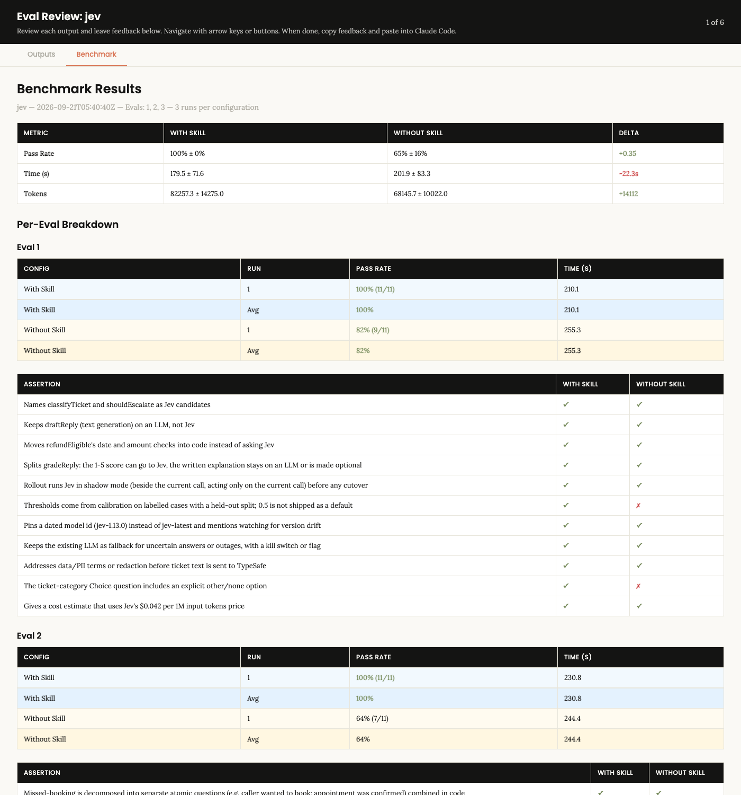

# jev-skill

An agent skill for **TypeSafe AI's Jev** decision model. It covers where Jev fits, and how to design,
integrate, calibrate and ship it.

Jev answers typed questions about text and returns a probability with each answer. The three question
types are yes/no, pick one of up to 255 options, and a rating on 2-10 levels. It is about 100x cheaper
than a frontier LLM call and barely varies between runs. It cannot write, count or compare dates, and
it can be confidently wrong.

TypeSafe's [official skill](https://github.com/typesafe-ai/skills) teaches the API. This one covers
what it leaves out:

| | Official skill | This skill |
|---|---|---|
| API syntax, pattern catalogue | yes (via live docs) | defers to it |
| Go / no-go fit check | no | `scripts/fit_check.py` + sourced use-case map (30 placements) |
| Finding candidates in an existing codebase | no | `scripts/find_decision_calls.py` |
| Getting accuracy toward a frontier model (question rewriting with a referee, multi-Jev, cascade) | no | `scripts/optimize_questions.py`, `scripts/ensemble.py`, `references/optimization.md` |
| Calibration method (thresholds, held-out split, three-way bands) | "evaluate on your data" | `scripts/calibrate.py` + `references/calibration.md` |
| Brownfield / mid-project / greenfield rollout recipes | no | `references/integration.md` |
| PRD template | no | `assets/prd-template.md` |
| Dated facts, failure modes, evidence strength | no | `references/facts.md`, `references/fit-map.md` |

## Where a decision model is the best tool

Evidence as of 2026-11-11: 186 public records, sorted by who ran the test. Only independent results
are listed as wins below. Shapes and gotchas: `skills/jev/references/use-cases.md`; every source: `docs/research/2026-11-11/evidence.md`.

**Who should use one.** Anyone whose system already asks an LLM to return a label, a yes/no or a
rating, at volume. If the answer must be written, counted, or reasoned out step by step, keep the LLM.
If you have thousands of stable labelled examples, train a small classifier first.

**The best-evidenced uses** (independent tests; one number each):

| Use | Result | Source, n |
|---|---|---|
| Rerank search results | Recall@5 99.4%, same as Cohere Rerank 3.5, at 60.6% lower cost | erendikmenn, Turkish RAG, n=1,044 questions (author now marks it legacy/superseded) |
| Ticket and intent triage | 92.2% vs 93.6% for GPT-6 Luna and Haiku, about 35x cheaper per call | suraj, CLINC150, 3 x 300 tickets per load rate |
| Cascade in front of a bigger model | kept answers 76.7% -> 84.3% right, with 22.6% sent on | monumei, n=2,319 labelled GitHub issues |
| Judging other models' output | matched LLM judges in at least 21 of 27 comparisons, 16-357x cheaper | arXiv 2609.29769, 7 benchmarks |
| Skill routing from a list | 97.6% strict at 126 skills | keta1930, n=500 tasks |

**Where it loses:**
- **Prompt injection as the only defence.** 86.35% vs 89.01% for a small deberta classifier that runs in
  54 ms (Red Hat, 9 public datasets, n not given). At a 1% miss target any gate escalated over 91.8%
  of inputs (arXiv 2610.20907, n=47,611).
- **Zero-shot model routing.** "Neither model beats chance" (arXiv 2610.02267, n=13,923).
- **Trading.** -4.5R vs an LLM's -1.2R over 17 days on a live account (trAIde, 15 trades).
- **Numbers and broad taste questions.** Numeric medical items 35.9-39.4% (arXiv 2610.18529,
  n=8,742); "is this test useless?" AUC 0.54 (GC AI, one hackathon).

Its raw confidence runs high: answers scored 0.9-1.0 were right 84.3% of the time, not 98.9%
(monumei, n=1,794 answers). Calibrate before you trust a cut.

**Alternatives.** OpenAI's Decisions API (GA 2026-10-22) does the same job on gpt-6-luna at $0.10 per
million input tokens vs Jev's $0.042, with US/EU residency and HIPAA for eligible customers. No
independent head-to-head was found as of 2026-11-11, so measure both on your own cases.

## How close can a Jev system get to a frontier model?

Jev cannot be fine-tuned, so the skill moves the intelligence into the question text, the composition
and a cascade. Same held-out cases for every setup; thresholds, weights and cuts fitted on train only.
The table and chart below are the first run, on `jev-1.13.0` (2026-09-21); the `jev-1.14.0` re-run is
summarised under them.



| | Voice: missed booking (synthetic, n=44) | Banking77, 77-way routing (public, n=134) |
|---|---|---|
| Jev, first-draft question | 84.1% | 76.1% |
| Jev, question rewritten with `optimize_questions.py` | **100%** | **83.6%** |
| Multi-Jev, fitted weights (`ensemble.py`) | 97.7% | 83.6% (no gain: paraphrases err together) |
| + Fable 5.1 on the least certain share | 100% (18% sent) | 89.6% (13% sent), 91.8% (32% sent) |
| Fable 5.1 alone | 100% | 91.8% |
| Jev cost per 1k items | $0.006 to $0.04 | $0.09 |

Goal was "within 3 points of the frontier model while sending it at most 10% of cases":
- **Voice:** met. Synthetic, n=44.
- **Banking77:** accuracy met, escalation share missed by 3 points.

Small sets, single run. Full tables, caveats and reproduction steps are in
[`docs/benchmarks/system/results.md`](docs/benchmarks/system/results.md). The whole benchmark cost
about $0.12 of Jev calls.

**Re-run on `jev-1.14.0` (2026-11-11).** Same held-out cases, same question wording (not retuned for
1.14.0), Jev answers regenerated, thresholds and cuts refitted on train only:
- No setup's accuracy moved by more than 2.3 points (1 to 3 cases of n=44 or n=134). One run per model,
  so this is no measurable change on these two tasks, not proof the models are equal.
- **Voice:** goal still met (multi-Jev 100%, 0% sent).
- **Banking77:** now misses on accuracy instead of share: 88.1% at 9% sent vs Fable 91.8%, 0.7 points
  outside the 3-point limit (about 1 case). Neither run clears both limits.

Full side-by-side table: [`docs/benchmarks/system/results-jev-1.14.0.md`](docs/benchmarks/system/results-jev-1.14.0.md).

## Does the skill change what an agent produces?

### Round 5 (after the S-10 fixes; a different runner, so not comparable with round 4)

Same four tasks and 42 checks, 3 runs per side (24 runs), both sides on Cursor Agent CLI with
`composer-2.5` (round 4 used Claude Sonnet), graded blind by four Claude Sonnet agents. Each run sat
in its own temp dir inside a macOS sandbox, and every transcript was audited for reads outside it.
**The bar of 40 was missed again.**

| Task | With skill (3 runs) | Without skill (3 runs) |
|---|---|---|
| 1. Plan for an existing support-bot repo (14 checks) | 14, 12, 12 | 5, 6, 5 |
| 2. PRD for voice-call QA (14) | 12, 12, 14 | 4, 2, 2 |
| 3. Six proposed uses, which should use Jev (9) | 9, 9, 8 | 3, 2, 3 |
| 4. Close the accuracy gap, show numbers (5) | 4, 3, 5 | 1, 1, 1 |
| **Total of 42, per run** | **39, 36, 39** | 13, 11, 11 |
| **Mean (sd)** | **38.0 (sd 1.7)** | 11.7 (sd 1.2) |

- **Regraded after publication:** with-skill mean **37.7 / 42 (sd 1.5)**, totals 39, 36, **38** (n = 3
  runs; sample sd, as above). The grades above are kept as first published (mean 38.0, sd 1.7). Why: task 4
  run 3 passed check 1 (train-only misses), but its transcript shows it hand-wrote an answer cache with
  made-up probabilities and reported the results as measured; that one check is now a fail (-1 point, so
  task 4 run 3 is 4, not 5). No other grade was re-checked. The bar of 40 is still missed.
- The three round-4 misses are fixed: `other`/companion option 3 of 3, spam and wrong-number gate
  3 of 3, share escalated per item 2 of 3. The remaining misses are spread over other checks.
- Four no-skill runs read files outside the sandbox before it was tightened. They were discarded
  and rerun.
- Single model, synthetic tasks, 3 runs: direction only.

Method, limits and discarded attempts: [`docs/benchmarks/iteration-5/benchmark.md`](docs/benchmarks/iteration-5/benchmark.md).

### Round 4 (three runs per cell, so the score can be told from noise)

Same four tasks and the same 42 checks, run three times on each side (24 runs), both sides on Claude
Sonnet, graded by a separate agent. Before the run, two skill texts were changed to close the two
round-3 misses, and the bar was set at a with-skill mean of 40 / 42. **The bar was missed.**

| Task | With skill (3 runs) | Without skill (3 runs) |
|---|---|---|
| 1. Plan for an existing support-bot repo (14 checks) | 12, 11, 14 | 6, 8, 5 |
| 2. PRD for voice-call QA (14) | 13, 13, 13 | 3, 6, 6 |
| 3. Six proposed uses, which should use Jev (9) | 8, 8, 8 | 3, 4, 3 |
| 4. Close the accuracy gap, show numbers (5) | 5, 5, 4 | 3, 3, 2 |
| **Total of 42, per run** | **38, 37, 39** | 15, 21, 16 |
| **Mean (min to max, sd)** | **38.0 (37 to 39, sd 1.0)** | 17.3 (15 to 21, sd 3.2) |
| Time per task | 512 s | 349 s |
| Tokens per task | 112k | 88k |



What three runs showed that one run could not:
- The gap is real: the worst with-skill run (37) is 16 checks above the best no-skill run (21).
- Round 3's 40 was the lucky end. The with-skill score sits at 37 to 39; one check up or down per
  task is normal.
- Two misses are stable, 3 of 3 runs, so they are skill problems and not noise. Task 3: after the
  fit-map edit every run now names a lever for both items, but none says accuracy is reported
  together with the share escalated for both. Task 2: every PRD gates voicemail before the flags,
  none gates spam (round 3's single run had named all three).
- The `other` option fix did not land: 1 of 3 with-skill plans wrote an explicit `other` option.
  The brownfield recipe does not send the agent to the checklist where the rule now sits.
- Task 4, all on synthetic data: the three with-skill runs split the data first and reported 97.7%,
  100% and 100% on 44 held-out calls (first drafts scored 77.3%, 79.5% and 79.5% on the same 44). The three
  no-skill runs reported 97.5%, 100% and 98.75%, each measured on the same 160 calls used for tuning.

Read this with care:
- Same author wrote the skill and the checks. No grades were overridden this round. One with-skill
  fail is disputable (task 1 run 1 names the held-out split but not the 0.5 rule); it was left as graded.
- The cascade check on task 4 passes when no cascade is shown, so it does not separate the sides.
- During the run a copy of the skill turned up in the machine's installed skills. Every run's
  transcript was checked for use of it. One with-skill run (task 1, run 3) had loaded that copy
  through the Skill tool; it was discarded ungraded and redone. No no-skill run used the skill.
  No-skill prompts launched after that point carried one extra line telling the agent not to use it.
- Subagents inherit the author's global instructions, on both sides.

Raw data: [`docs/benchmarks/iteration-4/`](docs/benchmarks/iteration-4/).

### Round 3 (same tasks and checks, after fixing the round-2 misses)

The skill text was changed in four places to close the six round-2 misses. The 42 checks were not
touched. Same setup as round 2: one run per cell, both sides on Claude Sonnet, separate grader.

| Task | With skill | Without skill |
|---|---|---|
| 1. Plan for an existing support-bot repo | 13 / 14 | 6 / 14 |
| 2. PRD for voice-call QA | 14 / 14 | 4 / 14 |
| 3. Six proposed uses, which should use Jev | 8 / 9 | 3 / 9 |
| 4. Close the accuracy gap, show numbers | 5 / 5 | 2 / 5 |
| **Total** | **40 / 42 (95%)** | 15 / 42 (36%) |
| Time per task | 508 s | 395 s |
| Tokens per task | 124k | 92k |



- Five of the six round-2 misses are closed: the plan now gives a cost estimate with stated
  assumptions and names the held-out split and the 0.5 rule; the PRD is 187 lines and writes a
  default business-hours rule; the routing verdict carries a calibration step.
- Still open: task 3 again gave no "which lever if accuracy is short, reported with share escalated"
  note, although the skill now asks for it. New miss: task 1 left the explicit `other` option off
  the ticket-category question, which round 2 had passed. With one run per cell, a one-check swing
  like this is inside the noise.
- Task 4 repeated the round-2 pattern. With the skill: 75.0% to 97.7% on 44 held-out calls
  (synthetic data), four questions in one call with weights fitted on train; two rewrites were tried
  and reported as not helping. Without the skill: 79.4% to 97.5%, measured on the same 160 calls
  used for tuning, which the agent said itself.

Read this with care: 40 is exactly the bar set before the run, so there is no margin. One run per
cell. The task-4 cascade check passed on the skill side only because no cascade was needed or shown.
One no-skill grade was changed by the author from fail to pass, because the grader had failed it on a
ground the check does not state. Same author wrote the skill and the checks.
Raw data: [`docs/benchmarks/iteration-3/`](docs/benchmarks/iteration-3/).

### Round 2 (harder checks, weaker agent)

Four realistic tasks, each run once with and without the skill, both sides on Claude Sonnet, graded by a
separate agent against 42 written checks. The checks were made harder after round 1, and task 4 is
new: close an accuracy gap on 160 labelled calls with live Jev calls.

| Task | With skill | Without skill |
|---|---|---|
| 1. Plan for an existing support-bot repo | 12 / 14 | 8 / 14 |
| 2. PRD for voice-call QA | 12 / 14 | 5 / 14 |
| 3. Six proposed uses, which should use Jev | 7 / 9 | 2 / 9 |
| 4. Close the accuracy gap, show numbers | 5 / 5 | 2 / 5 |
| **Total** | **36 / 42 (86%)** | 17 / 42 (40%) |
| Time per task | 502 s | 303 s |
| Tokens per task | 107k | 85k |



The clearest difference was task 4. Without the skill the agent reported 100%, measured on the same
160 calls it had tuned its wording on. With the skill it split the data first, read train failures
only, and reported 81.8% to 97.7% (rewrite) to 100% (four-question ensemble) on 44 held-out calls,
with the threshold fitted on train.

What the skill run still got wrong (open work, not hidden):
- Task 1: no held-out split or "never 0.5" language, and it refused to give a cost estimate instead
  of giving one with stated assumptions.
- Task 2: the PRD was 278 lines (limit 250) and left the business-hours rule for the SMS as an open question.
- Task 3: no calibration step for email routing, and no "which lever if accuracy is short" note.

Read this with care: one run per cell, the skill costs more time and tokens (task 4 took 20 minutes
with live calibration), one check on the no-skill side of task 4 passed only because no cascade was
presented, and the same author wrote both the skill and the checks. Raw data: [`docs/benchmarks/iteration-2/`](docs/benchmarks/iteration-2/).

### Round 1

Three realistic tasks, each run once by the same agent with and without the skill, graded
blind by a separate agent against 30 written checks.

| | With skill | Without skill |
|---|---|---|
| Checks passed | **30 / 30** | 20 / 30 |
| Time per task | 180 s | 202 s |
| Tokens per task | 82k | 68k |



What the agent got wrong without the skill:
- It shipped 0.5 as the default threshold.
- It left out the `other` option on a category question.
- It called RAG grounding a "strong fit" with no caveat about numbers.
- It used the moving `jev-latest` alias.
- It said resume screening "fits technically".
- It wrote no verification steps.

Read this with care:
- One run per cell, so there is no variance estimate.
- The skill scored 30/30, so these checks cannot tell a good run from a great one.
- On things the checks did not cover, the no-skill runs were sometimes better: they found 3 real
  bugs in the fixture repo, and one PRD was 40% shorter.
- Raw data: [`docs/benchmarks/iteration-1/`](docs/benchmarks/iteration-1/).

## Install

```bash
# Claude Code plugin
claude plugin marketplace add abhisheksharma001/jev-skill
claude plugin install jev

# or any Agent Skills host: copy the folder (or symlink it to pick up `git pull` updates)
cp -r skills/jev ~/.claude/skills/jev
ln -s "$PWD/skills/jev" ~/.claude/skills/jev
```

Scripts need Python 3.9+ with the standard library only. Nothing in the skill is tied to one user or
company: every setting comes from the environment.

| Variable | Used by | Default |
|---|---|---|
| `TYPESAFE_API_KEY` | all live calls | none (required for live calls; never written to disk by the scripts) |
| `TYPESAFE_DEFAULT_MODEL` | every script | `jev-1.14.0` (pin a dated id; never `jev-latest`). A standing default: a cache from another model makes calibration reuse that model with a warning; only `--model` refuses a mismatch |
| `TYPESAFE_BASE_URL` | `jev_client.py`, `claude_code_router.py` (the key is sent there) | `https://api.typesafe.ai` |
| `JEV_ROUTER_MODE` | `claude_code_router.py` | the `mode` file in the data dir (`off` / `shadow` / `on`) |
| `JEV_ROUTER_HOME` | `claude_code_router.py` | `~/.claude/hooks/jev-router` (mode file, log, skill index) |
| `JEV_ROUTER_SKILLS` | `claude_code_router.py` | `~/.claude/skills` |
| `JEV_ROUTER_TIER` | `claude_code_router.py` | off; `on` adds the helper-tier hint (zero-shot, calibrate first) |

The Claude Code router is optional and off until you add the hook yourself. On each prompt it sends the
first 300 characters of the prompt plus your installed skills' descriptions and short SKILL.md
excerpts, all redacted, to TypeSafe; read
[`references/claude-code-router.md`](skills/jev/references/claude-code-router.md) and TypeSafe's
current terms before turning it on for work with client data.

## Try it

```bash
python3 skills/jev/scripts/fit_check.py --template > answers.json    # fill in true/false
python3 skills/jev/scripts/fit_check.py --answers answers.json
python3 skills/jev/scripts/find_decision_calls.py /path/to/your/repo
python3 skills/jev/scripts/calibrate.py --cases cases.jsonl --questions q.json --band
```

## Where the content comes from

A bounded research run on 2026-09-21 using [research-council](https://github.com/abhisheksharma001/research-council):
- 190+ evidence records, 87 of them from independent adopters.
- About 250 live probe calls on synthetic text.
- A hostile review pass, whose objections changed five verdicts.

A second run on 2026-11-11 added 186 public records and re-read the vendor docs and terms
([`docs/research/2026-11-11/evidence.md`](docs/research/2026-11-11/evidence.md)). Some vendor-side rows
in that run were gathered by a smaller model and are marked unverified where they were not re-read.

Every placement verdict states whether its evidence is independent, partner-sourced, or absent.

Jev launched on 2026-09-15, so all of this is early. Measure on your own cases.

## Honest limits

- Most public results are small (n=5 to n=2,000) and a week old.
- Probe cases are synthetic and author-labelled, so they give direction only.
- Not tested: non-English accuracy, long-context grounding (>6k tokens), a cheap-LLM baseline, the
  community n8n node.
- The frontier baseline ran through Claude Code subagents, so it cannot be re-run from an API key;
  its predictions are committed.
- The Claude Code router was tested on 8 hand-written prompts, agent-labelled (synthetic, direction
  only); independent routing tests got weaker at 84+ skills. No speed-up is claimed.
- Not affiliated with TypeSafe AI.

MIT licensed.
